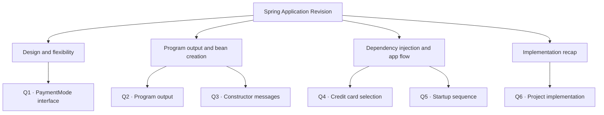

# Things to Know After the Project Is Completed (Q&A for Revision)

## Contents at a glance



---
## Q1. Why did we use an interface (PaymentMode) in this project?
PaymentMode defines a common rule (type): every payment method must have a paymentType() method.
The interface only declares the method. It has no body.
CreditCard, DebitCard and Upi implement it, and each writes its own paymentType().
Billcounter keeps a variable of type PaymentMode (p). So it can hold any payment object.
When Display() calls p.paymentType(), the method of whichever payment object is inside p runs (credit card, debit card or UPI).
⭐ So one rule lets Billcounter work with all payment methods without changing its own code.

---

## Q2. What output did the program give?

(This question was missing in what you sent, so I wrote it from your code.)

```
Credit Card object is created successfully
Debit Card object is created successfully
UPI object is created successfully
Payment done using Credit Card
```
The first lines are the “object created” messages from the constructors.
The last line is the payment message from paymentType().
Your wording of the messages may differ, but the order is the same.

---

## Q3. Why did we get the constructor messages?
In config.xml we defined four beans: cc, dc, u and bc.
```xml
<bean id="cc" class="com.excelr.CreditCard"/>
<bean id="dc" class="com.excelr.DebitCard"/>
<bean id="u" class="com.excelr.Upi"/>
<bean id="bc" class="com.excelr.Billcounter">
    <constructor-arg ref="cc" name="p"/>
</bean>
```
Spring created the objects of CreditCard, DebitCard, Upi and Billcounter.
When each object is created, its constructor runs. We wrote a print statement inside the constructors, so the messages appear.
⭐ These messages come from our print statements. Spring does not print them by itself.
Check: in the Billcounter code you pasted, the constructor has no print line. So you get 3 messages (credit card, debit card, UPI), even though 4 objects are created. You get 4 messages only if you added a print line in the Billcounter constructor.

---

## Q4. Why did only the credit card payment message execute?
In the bc bean we wrote <constructor-arg ref="cc" name="p"/>.
ref="cc" tells Spring: “pass the object with bean id cc into the Billcounter constructor.” (name="p" says which constructor parameter gets it.)
The constructor is:
```java
public Billcounter(PaymentMode p) {
    this.p = p;
}
```
p receives the CreditCard object, because CreditCard implements PaymentMode.
Display() calls p.paymentType(). Since p holds a CreditCard, the credit card’s paymentType() runs.
Debit card and UPI objects were also created, but we didn’t pass them to Billcounter, so their payment methods did not run.
⭐ To use UPI, change ref="cc" to ref="u". No Java code changes.

---

## Q5. What is the main concept, and what happens in the background when the application starts?

Main concept: we used Spring’s XML configuration to create objects and to inject one object into another through constructor injection.

What happens in the background:

We run Main.java. It loads config.xml using the container.
Spring reads config.xml and sees the beans we defined.
Spring creates the objects. As each payment object is created, its constructor runs and prints its own “object created” message.
Then constructor injection happens in the bc bean. Spring passes the credit card object (cc) into the Billcounter constructor, so p now holds the credit card object.
Main gets the bc object and calls Display().
Display() calls p.paymentType(). Because p is the credit card object, the credit card payment message is printed.

⭐ There are two kinds of messages in the output:

Object created messages come first, from the constructors, when Spring creates the beans.
The payment message comes last, when Display() runs. It comes from the object that was injected.

---

## Q6. What did we do in this project, and how did we implement it?

What we did:
We made a payment interface and ran different payments (credit card, debit card, UPI) through it. We created the payment objects in config.xml and made a Billcounter bean. Whichever payment bean we give to Billcounter with constructor-arg ref, that payment method runs.

How we implemented it:

Created an interface: PaymentMode.java with the paymentType() method.
Implemented the interface: CreditCard.java, DebitCard.java and Upi.java. Each implements PaymentMode and writes its own paymentType().
Created the Billcounter class: it has a PaymentMode variable p, and a constructor that accepts a PaymentMode object and stores it with this.p = p.
Configured objects in config.xml: beans for the payment classes and for Billcounter.
Used constructor injection: in the Billcounter bean, <constructor-arg ref="cc" name="p"/> passes the credit card object.
Executed the project: in Main.java, we loaded config.xml, got the Billcounter object with getBean, and called Display().